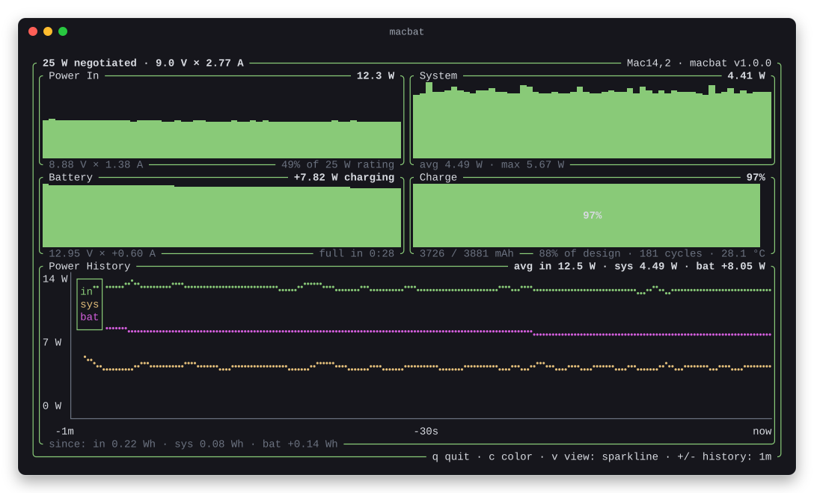

# macbat

Sudoless power monitor for Apple Silicon laptops, in the style of [macmon](https://github.com/vladkens/macmon).
Shows what the power adapter is delivering, what the system is drawing, and whether the battery is
charging or covering a shortfall — live, and over time.



## Install

With [Homebrew](https://brew.sh):

```sh
brew install patsissons/tap/macbat
```

### From source

Needs a Rust toolchain ([rustup.rs](https://rustup.rs)).

```sh
cargo install --git https://github.com/patsissons/macbat
```

Or from a clone:

```sh
scripts/install.sh                        # release build → ~/.local/bin/macbat
BINDIR=/usr/local/bin scripts/install.sh  # or pick another directory
```

`scripts/build.sh` builds without installing (release by default, `--debug` for a debug build).
`scripts/run.sh [args]` runs the current source without installing (e.g. `scripts/run.sh pipe -s 1`).
`cargo install --path .` also works.

## Usage

```sh
macbat                 # TUI
macbat -i 500          # TUI, sample every 500 ms
macbat pipe            # JSON lines, one sample per interval
macbat pipe -s 1 | jq  # single sample
macbat debug           # raw SMC keys + battery registry entry
macbat debug P         # every SMC key starting with "P"
```

Keys: `q` quit · `c` cycle color · `v` sparkline/gauge view · `r` sparkline scale · `+`/`-` history window (1m, 5m, 15m, 1h).

`r` cycles the sparkline scale:

- **default**: Power In against the charger's negotiated power, System and Battery against their visible peak.
- **auto**: every panel against its visible peak, marked by a line above the bars labelled with that peak (signed for Battery: + charging, − discharging).
- **full**: every panel from 0 to the charger's negotiated power (the session peak if that's higher, or on battery).
Preferences persist in `~/.config/macbat.json`.

## Where the numbers come from

| Metric | Source | Notes |
|---|---|---|
| Power in (W, V, A) | SMC `PDTR`, `VD0R`, `ID0R` | DC input after the USB-C/MagSafe port, ~1 s refresh |
| System power | SMC `PSTR` | Whole-system draw (same value macmon calls `sys_power`) |
| Battery V / A | SMC `B0AV`, `B0AC` | Little-endian ints on Apple Silicon; A is signed (− = discharging). Cross-checked against the registry voltage |
| Battery power | `B0AV × B0AC` | + charging, − discharging |
| Battery temp | SMC `TB0T`–`TB2T` | Average of the pack sensors |
| Negotiated adapter W/V/A, charger offers, charge %, mAh, cycles, time to full/empty | IORegistry `AppleSmartBattery` | Same data as `ioreg -rw0 -c AppleSmartBattery` |

The `AppleSmartBattery` registry entry also has `PowerTelemetryData` (system power in/load, battery
power), but it only refreshes every ~30–60 s, so it is used only as a fallback when the SMC is
unavailable (the header then says "registry only").

Sensors are read at slightly different moments, so on a single sample `in ≈ system + battery`
can be off by a watt or two during load spikes; the averages in the history panel line up.

The header's wattage is what the Mac and charger negotiated over USB-PD (`AdapterDetails.Watts`), not
the number on the charger. It is limited by the levels the charger offers (`adapter.offers` in
`pipe`) and by what the Mac accepts. A charger only offers more than 3 A when the cable is rated
for 5 A, so a 70 W charger on a standard USB-C cable negotiates 60 W; the header flags that case
as "3 A cable limit". Dual-port chargers often offer less than their label per port.

"% of design" is `NominalChargeCapacity / DesignCapacity`. macOS's "Maximum Capacity" in System
Settings uses its own (unpublished) formula and may differ by a few percent.

## License

[MIT](LICENSE)
